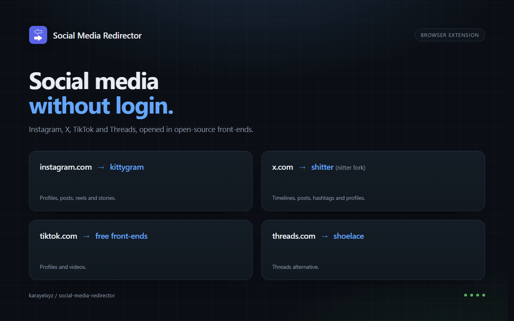
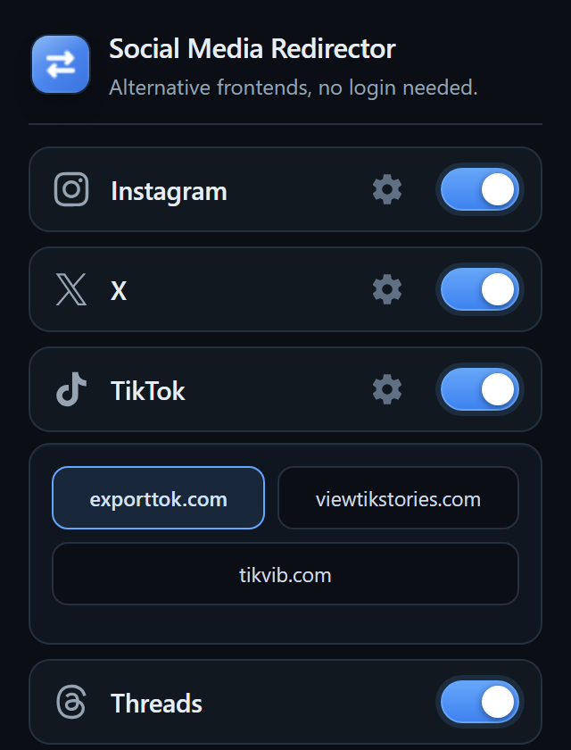

<p align="center"></p>

<h1 align="center">Social Media Redirector</h1>

<p align="center">Read Instagram, X, TikTok and Threads without an account.<br>
Every page is forwarded to a front-end that serves it without a login wall.</p>

<p align="center">
  <a href="https://chromewebstore.google.com/detail/social-media-redirector/gckenkjdlidnignifbbobohimoilmgcg"></a>
  <a href="https://addons.mozilla.org/en-US/firefox/addon/social-media-redirector/"></a>
  <a href="https://microsoftedge.microsoft.com/addons/detail/social-media-redirector/ahioadaknnlfbkdhmebmkhnjllglcffj"></a>
</p>

<p align="center">
  <a href="https://karayelxyz.github.io/social-media-redirector"></a>
  <a href="CHANGELOG.md"></a>
  <a href="#license"></a>
</p>

## What it does

| Platform | You open | You land on |
|---|---|---|
| Instagram | `instagram.com/...` | **kittygram** — `kittygram.irelephant.net` |
| X | `x.com/...` | **shitter**, a Nitter fork — `shitter.thepixora.com` |
| TikTok | `tiktok.com/@user/video/...` | **exporttok**, **tikvib** or **viewtikstories** |
| Threads | `threads.com/...` | **shoelace** — `shoelace.mint.lgbt` |

Only the host changes, so a profile, post or video opens on the page it would have opened on the
original site. Instagram, X and TikTok front-ends are chosen per platform in the popup; the defaults
are the ones above.

TikTok front-ends disagree about their URL shape, so each one gets its own mapping:

| Front-end | Video | Profile |
|---|---|---|
| exporttok | `/tiktok/account/viewer/@user/123` | `/tiktok/account/user` |
| tikvib | `/media/123` | `/profile/user` |
| viewtikstories | `/comments/123` | `/profile/user` |

## The popup



- **A switch per platform.** Off means the site opens normally and the extension stays out of the way.
- **⚙ on Instagram, X and TikTok** picks the front-end instance. X and Instagram accept any host;
  TikTok offers its three front-ends as buttons.
- **No login.** The front-ends serve public pages, so nothing asks for an account.
- Works in Chrome, Edge and Firefox — one codebase, two manifests.

<br clear="right">

## Installation

Use the store buttons above; the stores keep the extension up to date. To install a build by hand:

<details>
<summary><b>Chrome / Edge</b></summary>

1. Download `social-media-redirector-chrome.zip` from the [latest release](https://github.com/karayelxyz/social-media-redirector/releases) and unzip it.
2. Open `chrome://extensions` (or `edge://extensions`) and turn on **Developer mode**.
3. Click **Load unpacked** and pick the unzipped folder — or drag the `.crx` file onto that page.

</details>

<details>
<summary><b>Firefox</b></summary>

1. Download the signed `.xpi` from the [latest release](https://github.com/karayelxyz/social-media-redirector/releases).
2. Open `about:addons` → gear icon → **Install Add-on From File** → pick the `.xpi`.

</details>

Builds installed by hand do not update themselves.

## Bookmarklet

No extension, no install: a bookmark that runs the same redirects. Visit the
[landing page](https://karayelxyz.github.io/social-media-redirector) to pick the front-end instances
and get the code generated for you.

<details>
<summary>Show the bookmarklet code (default instances)</summary>

```
javascript:(function()%7Bvar%20K%3D%22https%3A%2F%2Fkittygram.irelephant.net%22%2CN%3D%22https%3A%2F%2Fshitter.thepixora.com%22%2CT%3D%22https%3A%2F%2Fexporttok.com%22%2CTK%3D%22exporttok.com%22%2Cu%3Dnew%20URL(location.href)%2Ch%3Du.hostname%2Cp%3Du.pathname%2Cq%3Du.search%2Cs%3Du.searchParams%2CAL%3D%5B%22%2Fexplore%22%2C%22%2Fdirect%22%2C%22%2Faccounts%22%2C%22%2Fabout%22%2C%22%2Fhacked%22%2C%22%2Fprivacy%22%2C%22%2Fpopular%22%5D%3Bfunction%20al(x)%7Breturn%20AL.some(function(a)%7Breturn%20x%3D%3D%3Da%7C%7Cx.indexOf(a%2B%22%2F%22)%3D%3D%3D0%7D)%7Dfunction%20go(t)%7Blocation.href%3Dt%7Dfunction%20tk(u%2Cr)%7Bif(TK%3D%3D%3D%22tikvib.com%22)%7Bif(r%3D%3D%3D%22followers%22%7C%7Cr%3D%3D%3D%22following%22)return%20T%2B%22%2F%22%2Br%2B%22%2F%22%2Bu%3Bif(r%3D%3D%3D%22repost%22%7C%7Cr%3D%3D%3D%22reposts%22)return%20T%2B%22%2Freposts%2F%22%2Bu%3Breturn%20T%2B%22%2Fprofile%2F%22%2Bu%7Dif(TK%3D%3D%3D%22viewtikstories.com%22)%7Bif(r%3D%3D%3D%22followers%22%7C%7Cr%3D%3D%3D%22following%22%7C%7Cr%3D%3D%3D%22repost%22%7C%7Cr%3D%3D%3D%22reposts%22%7C%7Cr%3D%3D%3D%22playlist%22)return%20T%2B%22%2Fprofile%2F%22%2Bu%2B%22%3Ftab%3D%22%2B(r%3D%3D%3D%22repost%22%3F%22reposts%22%3Ar)%3Breturn%20T%2B%22%2Fprofile%2F%22%2Bu%7Dreturn%20T%2B%22%2Ftiktok%2Faccount%2F%22%2Bu%7Dif(%2F(%5E%7C%5C.)instagram%5C.com%24%2F.test(h))%7Bvar%20np%3Dp%3Bif(p.indexOf(%22%2Faccounts%2Flogin%22)%3D%3D%3D0)%7Bvar%20n%3Ds.get(%22next%22)%3Bif(!n)return%3Bnp%3Dn.indexOf(%22http%22)%3D%3D%3D0%3Fnew%20URL(n).pathname%2Bnew%20URL(n).search%3An%7Dif(al(np.split(%22%3F%22)%5B0%5D))return%3Bgo(K%2Bnp)%3Breturn%7Dif(%2F(%5E%7C%5C.)x%5C.com%24%2F.test(h))%7Bif(%2F%5E%5C%2Fi%5C%2F(jf%5C%2Fonboarding%7Cflow)%2F.test(p))return%3Bvar%20hm%3Dp.match(%2F%5E%5C%2Fhashtag%5C%2F(%5B%5E%2F%3F%23%5D%2B)%2F)%3Bif(hm)%7Bgo(N%2B%22%2Fsearch%3Ff%3Dtweets%26q%3D%2523%22%2Bhm%5B1%5D)%3Breturn%7Dgo(N%2Bp%2Bq)%3Breturn%7Dif(%2F(%5E%7C%5C.)tiktok%5C.com%24%2F.test(h))%7Bvar%20v%3Dp.match(%2F%5E%5C%2F%40(%5B%5E%2F%5D%2B)%5C%2F(%3F%3Avideo%7Cphoto)%5C%2F(%5B0-9%5D%2B)%2F)%3Bif(v)%7Bgo(T%2B(TK%3D%3D%3D%22tikvib.com%22%3F%22%2Fmedia%2F%22%2Bv%5B2%5D%3ATK%3D%3D%3D%22viewtikstories.com%22%3F%22%2Fcomments%2F%22%2Bv%5B2%5D%3A%22%2Ftiktok%2Faccount%2Fviewer%2F%40%22%2Bv%5B1%5D%2B%22%2F%22%2Bv%5B2%5D))%3Breturn%7Dvar%20ta%3Dp.match(%2F%5E%5C%2F%40(%5B%5E%2F%5D%2B)(%3F%3A%5C%2F(%5B%5E%2F%3F%23%5D%2B))%3F%2F)%3Bif(ta)%7Bgo(tk(ta%5B1%5D%2Cta%5B2%5D%7C%7C%22%22))%3Breturn%7Dreturn%7Dif(%2F(%5E%7C%5C.)threads%5C.com%24%2F.test(h))%7Bvar%20tp%3Dp.match(%2F%5E%5C%2F%40%5B%5E%2F%5D%2B%5C%2Fpost%5C%2F(%5B%5E%2F%5D%2B)%2F)%3Bif(tp)%7Bgo(%22https%3A%2F%2Fshoelace.mint.lgbt%2Ft%2F%22%2Btp%5B1%5D)%3Breturn%7Dif(%2F%5E%5C%2F(login%7Csearch%7Cexplore%7Cactivity%7Csettings%7Capi%7Cshare)%2F.test(p))return%3Bvar%20th%3Dp.match(%2F%5E%5C%2F%40(%5B%5E%2F%3F%23%5D%2B)%2F)%3Bif(th)%7Bgo(%22https%3A%2F%2Fshoelace.mint.lgbt%2F%40%22%2Bth%5B1%5D)%3Breturn%7D%7D%7D)()%3B
```

</details>

Add it as the URL of a new bookmark, then click it on any Instagram, X, TikTok or Threads page.

## How it works

- **Redirects are `declarativeNetRequest` rules**, rebuilt whenever a switch or an instance changes,
  so the original page never gets a chance to render.
- **`webNavigation` covers what a network filter cannot**: login pages carrying a `next` target
  (Instagram `/accounts/login?next=`, X `/i/flow?...redirect_after_login=`) and single-page apps that
  swap the URL without a request (a TikTok video opened from a profile). Those tabs are moved before
  the page finishes loading.
- **A small content script** is the last resort for navigations a browser serves from its own cache.
  It polls the URL once a second, and only while the tab is visible.
- **Nothing leaves the browser.** No analytics, no telemetry, no remote code, no request to us. The
  only network call anywhere in the project is the star counter on the landing page.

## Development

```
Extension/        the add-on: background.js (rules + navigation), content.js, popup, icons
test/             redirect and bookmarklet tests
store-assets/     listing images for the three stores
index.html        landing page (GitHub Pages) and the bookmarklet generator
```

Run the tests — no dependencies, just Node:

```bash
node test/redirect.test.js
```

They load the real source from `Extension/background.js`, `Extension/popup.js` and `index.html` and
check the forwarding table, the instance swap, the bookmarklet, and that the removed reverse
direction stays removed.

Build the packages by hand:

```bash
# Chrome / Edge — manifest.json at the root of the zip
mkdir -p dist-chrome
cp Extension/manifest.json Extension/background.js Extension/content.js Extension/popup.html Extension/popup.js dist-chrome/
cp -r Extension/images dist-chrome/
(cd dist-chrome && zip -r ../social-media-redirector-chrome.zip .)

# Firefox — same files, but manifest-firefox.json renamed to manifest.json
mkdir -p dist-firefox
cp Extension/manifest-firefox.json dist-firefox/manifest.json
cp Extension/background.js Extension/content.js Extension/popup.html Extension/popup.js dist-firefox/
cp -r Extension/images dist-firefox/
(cd dist-firefox && zip -r ../social-media-redirector-firefox.zip .)
```

Releases are built by GitHub Actions on a manifest change — see
[`.github/workflows/release.yml`](.github/workflows/release.yml). Pull requests run the tests and the
version check in [`.github/workflows/ci.yml`](.github/workflows/ci.yml).

## Privacy

The extension reads tab URLs to decide what to redirect and keeps your switches and instance choices
in local storage. Nothing is collected, nothing is sent. The full text is in
[PRIVACY_POLICY.html](PRIVACY_POLICY.html).

## Contributing

Bug reports, front-end suggestions and pull requests are welcome — read
[CONTRIBUTING.md](CONTRIBUTING.md) first. Changes are tracked in [CHANGELOG.md](CHANGELOG.md).

## License

MIT
